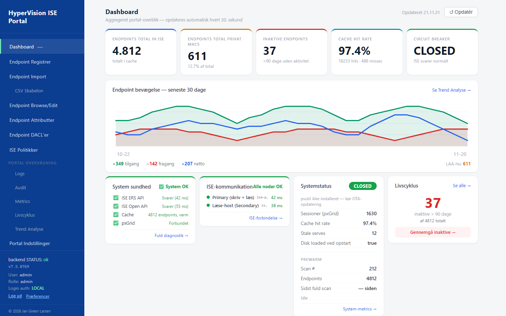
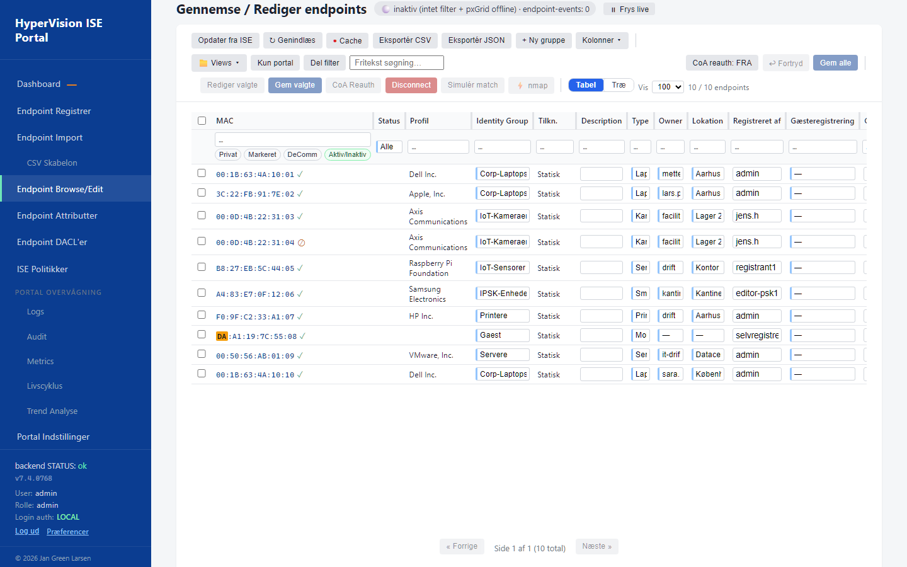
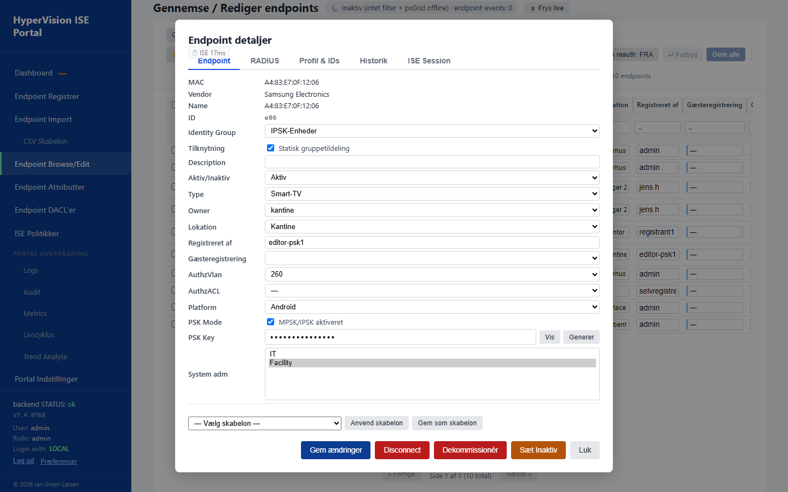
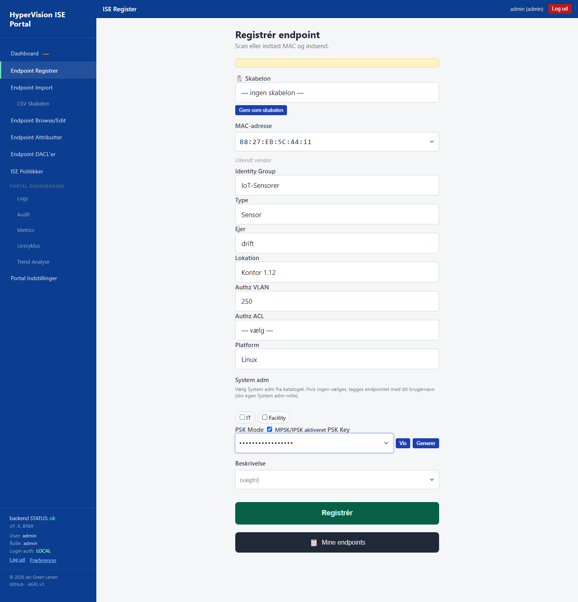
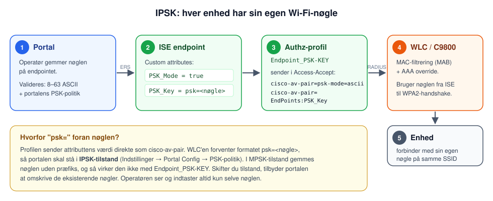
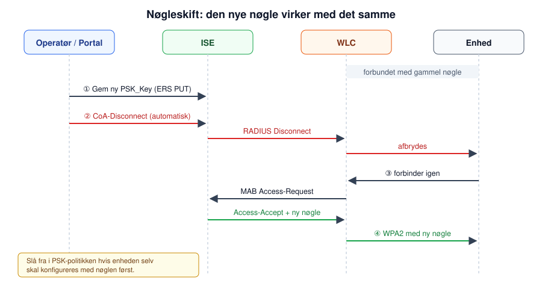

<!-- Version: 7.3.0766 | Opdateret: 2026-11-20 -->

# 03 — Brugervejledning

---

## Sidebar og brugerinfo

Sidebarens nederste del viser tre linjer om den aktuelle session:

| Linje | Indhold |
|---|---|
| **User** | Brugernavn du er logget ind med |
| **Rolle** | Din portal-rolle (admin, editor, viewer osv.) |
| **Login auth** | `TACACS+` (blå) hvis logget ind via TACACS+-server, `LOCAL` (grøn) hvis lokal passwordauth |

Herunder er der links til **Log ud** og **Præferencer**.

### Præferencer

Præferencer-siden er tilgængelig for alle brugere uanset auth-metode.

- **Brugere med lokal auth** kan skifte password samt justere frontend-præferencer (tema, sidestørrelse).
- **TACACS+-brugere** kan justere frontend-præferencer, men kan ikke skifte password — passwords administreres af TACACS+-serveren. Passwordformularen erstattes af en informationsbesked.

---

## Dashboard

Dashboardet er startsiden for admin, editor og viewer. Øverst vises nøgletal: antal endpoints i ISE, private (tilfældige) MAC-adresser, inaktive endpoints, cachens hit rate og status for ISE-forbindelsens circuit breaker. Herunder vises tilgang og fragang af endpoints de seneste 30 dage, systemets sundhed, forbindelsen til hver ISE-node og de seneste hændelser. Siden opdateres automatisk hvert 30. sekund.



*Dashboardet. Et rødt eller gult kort betyder, at noget kræver opmærksomhed; klik på linket i kortet for detaljer.*

---

## Browse og Edit

Browse er portalens primære arbejdsside. Den viser alle endpoints du har adgang til som en tabel med filtrering, søgning, kolonnevalg og realtids sessions-farvning.



*Browse. Hvert felt kan rettes direkte i tabellen; ændringer gemmes med "Gem valgte" eller "Gem alle". Et grønt flueben ved MAC-adressen betyder aktiv session.*

### Tabel-kolonner

Standardkolonner der vises ved opstart:

| Kolonne | Indhold |
|---|---|
| Checkbox | Vælg række til bulk-operationer. Grøn = aktiv RADIUS-session; rød = ingen session |
| MAC-adresse | Endpointets MAC |
| Identity Group | ISE endpoint-gruppe |
| Beskrivelse | Fritekstbeskrivelse |
| HypervisionRoles | System adm-tag(s) — afgrænser hvem der kan se endpoint |
| AuthzVlan | Autorisations-VLAN (custom attribute) |
| AuthzACL | Autorisations-ACL (custom attribute) |
| PSK Key | PSK-nøgle — kun synlig for editor-psk og admin |
| Owner / Location | Custom attributes til ejerskab og placering |
| System adm | Kombineret system adm-info |

Kolonner kan til- og fravælges via **Kolonner**-knappen i værktøjslinjen. Valget gemmes i browser localStorage.

### Søg og filtrer

- **Søgefelt**: fritekst-søgning på MAC, beskrivelse og custom attributes. Søgningen sker mod den indlæste data-side — ikke en fuld ISE-søgning på tværs af alle sider.
- **Filter**: dropdown med Identity Group, system adm-tags og andre attribut-værdier. Flere filtre kombineres med AND.

### Sessionsfarve (grøn/rød)

Checkboxens baggrund afspejler om endpoint har en aktiv RADIUS-session i ISE:

- **Grøn**: aktiv session — klienten er autentificeret og tilknyttet
- **Rød/hvid**: ingen aktiv session

Farvning opdateres via pxGrid i realtid (hvis aktiveret) eller ved MnT-poll-interval.

### Edit-modal

Dobbeltklik på en rækkes MAC-adresse (eller brug ▶-pilen) for at åbne edit-modalen. Modalen henter altid de seneste data direkte fra ISE.



*Edit-modalen for en IPSK-enhed. PSK-felterne vises kun for admin og editor-psk. "Vis" viser nøglen, "Generer" laver en ny efter PSK-politikken.*

Felter du kan redigere:

- Beskrivelse
- Identity Group
- Custom attributes (AuthzVlan, AuthzACL, Owner, Location, PSK_Key, PSK_Mode, HypervisionRoles, m.fl.)

Klik **Gem** for at sende ændringen til ISE via `PUT /api/endpoints/{id}`.

**Prøv igen-knap**: hvis ISE er midlertidigt utilgængeligt vises en venlig fejlbesked med en **Prøv igen**-knap. Portalen viser evt. cachelagrede data med et ⏱-badge som indikerer at data muligvis er forældet.

### Policy-simulering

Fanen med ISE-politik i edit-vinduet viser, hvilken autorisationsregel endpointet vil ramme. Vælg et policy set, eller **Auto** for at teste alle policy sets i rank-rækkefølge, og klik **Simulér**. Endpointets attributter hentes altid live fra ISE. RADIUS-værdier, som reglerne bruger (fx `Called-Station-ID`), kan tilføjes som rækker og gemmes som skabeloner.

Under resultatet står, hvor lang tid simuleringen tog, og hvor policy-reglerne kom fra:

| Tekst | Betydning |
|---|---|
| *fra cache* | Reglerne var hentet inden for 5 minutter. Kun endpointet blev hentet fra ISE |
| *fra cache (opdateres i baggrunden)* | Reglerne er 5–60 minutter gamle og bruges med det samme, mens de hentes på ny |
| *hentet fra ISE* | Reglerne var ikke i cachen. Alle policy sets hentes parallelt |

Reglerne begynder at blive hentet, så snart fanen åbnes, så den første simulering normalt også går hurtigt. Ændringer, der laves i portalen, slår igennem med det samme. Ændringer, der laves direkte i ISE, ses i den simulering der kommer efter baggrundsopdateringen — og altid efter højst en time.

### Bulk-edit

Marker flere rækker (Shift+klik for interval) og klik **Bulk-edit** i toolbar. Du kan redigere ét eller flere felter på alle markerede endpoints på én gang.

### CoA (Change of Authorization)

Fra toolbar-knapperne eller edit-modal:

- **CoA Reauth**: tvinger ISE til at evaluere klientens policy på ny uden at kaste sessionen. Brug når du har ændret VLAN eller ACL og ønsker øjeblikkelig effekt.
- **CoA Disconnect**: deautentificerer klienten (session fjernes fra WLC/switch). Klienten kører DHCP DORA på ny og får en ny IP. Brug ved VLAN-skift der kræver ny IP.

CoA sendes via MnT API og kræver MnT Admin-rettigheder på ISE-kontoen. Rollerne **admin**, **editor** og **editor-psk** kan sende CoA — også som massehandling. Du kan kun sende CoA til endpoints i dine egne System adm-tags.

---

## Opret endpoint

Navigér til **Opret** i menuen.



*Opret endpoint. Vælges en skabelon, udfyldes gruppe og attributter automatisk. Vendor slås op ud fra MAC-adressen.*

Påkrævede felter:

- **MAC-adresse**: format `AA:BB:CC:DD:EE:FF` eller `AA-BB-CC-DD-EE-FF`. Bindestreg og kolon accepteres og normaliseres.
- **Identity Group**: vælg fra dropdown (hentes live fra ISE).

Valgfrie felter:

- Beskrivelse
- Custom attributes (AuthzVlan, AuthzACL, PSK-felter m.fl.)
- HypervisionRoles (System adm-tag) — udfyldes automatisk med dit brugernavn hvis du ikke vælger andet og ikke er admin

Klik **Opret** — portalen sender `POST /api/endpoints` og viser bekræftelse med ISE-ID.

---

## Import fra CSV

Navigér til **Import** i menuen.

Portalen understøtter to CSV-formater:

### ISE-format (fuld export fra ISE)

Headerrække med kolonnenavne som `MACAddress`, `IdentityGroup`, `CustomAttributes.VLAN_ID` osv. Portalen auto-detekterer formatet og mapper kolonner til ISE-felter.

### Simpelt format

Minimal CSV med kun de felter du har:

```
MAC,Identity Group,Beskrivelse,AuthzVlan
AA:BB:CC:11:22:33,Employees,Printer 3. sal,VLAN20
```

### Import-flow

1. Upload CSV-fil — portalen viser en preview med mapning og de første rækker.
2. Tjek at kolonner er korrekt mappet. Justér evt. manuelt.
3. Klik **Importér** — portalen opretter endpoints én ad gangen og viser en succeeded/failed-rapport.

Fejlede rækker (f.eks. duplikeret MAC i ISE, ugyldigt format) vises med årsag i rapporten. Vellykkede rækker importeres uanset fejlede.

---

## Attributter

Navigér til **Attributter** i menuen (kræver editor- eller admin-adgang).

Attribut-siden lader dig administrere de custom attributes portalen bruger.

### Custom attribute-definitioner

Listen viser alle custom attributes defineret i ISE via Open API. Du kan:

- Tilføje nye custom attribute-definitioner direkte til ISE
- Redigere eksisterende definitioner (navn og type)

**Bemærk**: Sletning af en custom attribute-definition i ISE fjerner attributten fra alle endpoints — dette er irreversibelt.

### PlatformType-mapping

Portalen kan mappe en enhedstype (f.eks. `PLC`, `Printer`, `IP-kamera`) til forudbestemte ISE-attribut-værdier. Når du opretter et endpoint og vælger PlatformType udfyldes AuthzVlan, AuthzACL og Identity Group automatisk med de mappede standardværdier.

Rediger mapping-tabellen og klik Gem. Mapping gemmes i portal-konfigurationen (ikke i ISE).

### CoA-binding

Du kan konfigurere at specifikke attribut-ændringer (f.eks. ændring af AuthzVlan) automatisk udløser CoA Reauth ved Gem i edit-modal. Slå bindings til/fra per attribut.

---

## ACL-editor

Navigér til **ACL** i menuen (kræver editor- eller admin-adgang).

ACL-editoren administrerer Downloadable ACL'er (DACL'er) i ISE.

### Liste

Viser alle DACL'er defineret i ISE med navn, type (IP/IPv6) og linjetal.

### Redigér DACL

Klik på en DACL for at åbne editoren. Editoren har:

- Fritekst-felt til Cisco IOS ACL syntax
- **Live syntaksvalidering**: portalen checker ACL-linjer mens du skriver og markerer ugyldige linjer
- **Gem til ISE**: sender den redigerede DACL tilbage til ISE via Open API

### Gyldig Cisco IOS ACL-syntax

```
permit ip any any
deny ip 10.0.0.0 0.255.255.255 any
permit tcp any any eq 443
permit udp any any eq 53
deny ip any any
```

ACL-validatoren kender de mest brugte Cisco IOS ACE-varianter. Ukendte konstruktioner markeres med advarsel men blokerer ikke for Gem.

---

## PSK-workflow

Med Identity PSK (IPSK) får hver enhed sin egen Wi-Fi-nøgle på samme SSID. Portalen gemmer nøglen på endpointet i ISE. Når enheden forbinder, slår ISE nøglen op og sender den til controlleren via autorisationsprofilen `Endpoint_PSK-KEY`. En enkelt enheds nøgle kan derfor skiftes eller tilbagekaldes uden at røre de andre.



*Nøglens vej fra portal til enhed. ISE-reglen matcher fx EndPoints:PSK_Mode EQUALS true.*

Opsætningen i ISE (profil og regel) er beskrevet i [Administration → PSK-politik](04-ADMIN.md#psk-politik).

### PSK-felter

- **PSK_Mode**: til/fra (`true`/`false`). Angiver om endpointet skal have en personlig nøgle. Feltet bruges typisk som betingelse i ISE-reglen.
- **PSK_Key**: selve nøglen. Den vises som `••••` for brugere uden PSK-ret. Uanset om portalen kører i IPSK- eller MPSK-mode, ser du altid nøglen uden `psk=`-præfiks. Portalen tilføjer eller fjerner præfikset selv.

### Krav til nøglen

En nøgle skal være **8–63 tegn** og må kun indeholde almindelige ASCII-tegn: bogstaver a–z og A–Z, tal, mellemrum og tegn som `!@#$%&*-_=+`. **Æ, ø og å kan ikke bruges**, fordi Wi-Fi ikke understøtter dem. Admin kan stramme kravene yderligere i PSK-politikken, fx med en højere minimumlængde eller krav om tal. Brug knappen **Generer** for at få en tilfældig nøgle, der opfylder politikken.

### Hvem kan hvad

| Rolle | PSK |
|---|---|
| **admin**, **editor-psk** | Kan se nøgler i klartekst, oprette og ændre dem og sende CoA |
| **editor**, **viewer** | Ser `••••`. Kan ikke ændre PSK-felterne; de ignoreres, hvis de alligevel sendes til portalens API |
| **registrant**, **registrant_templet** | Kan ikke sætte PSK. For registrant_templet kommer PSK_Mode fra skabelonen |

### Opret endpoint med PSK

1. Gå til **Endpoint Registrer**.
2. Udfyld MAC, Identity Group og øvrige felter.
3. Sæt flueben i **MPSK/IPSK aktiveret** under PSK Mode, og udfyld **PSK Key**, eller klik **Generer**.
4. Klik **Registrér**.

### Skift eller tilbagekald en nøgle

Åbn endpointet i Browse, ret **PSK Key** (eller fjern fluebenet i **PSK Mode**), og gem. Portalen sender derefter automatisk **CoA-Disconnect** til enheden. Enheden afbrydes og skal forbinde igen med den nye nøgle. Disconnect bruges frem for Reauth, fordi en ny nøgle kræver en ny forbindelse.



*Nøgleskift med automatisk CoA-Disconnect.*

Efter gemning står der, om afbrydelsen lykkedes:

| Besked | Betydning |
|---|---|
| *enheden er afbrudt og skal forbinde igen* | Den gamle nøgle virker ikke længere |
| *afbrydelse fejlede (...)* | Typisk fordi enheden ikke er online. Den gamle nøgle virker, til enheden selv forbinder igen |
| *automatisk afbrydelse er slået fra* | Admin har slået funktionen fra i PSK-politikken |

> **Bemærk:** En enhed, der ikke selv har fået den nye nøgle, kommer ikke på igen. Opdatér enheden først, eller gør det med det samme bagefter.

---

## Register-view (registrant / registrant_templet)

Rollerne `registrant` og `registrant_templet` har adgang til et mobiloptimeret register-view tilpasset fieldteknikere der registrerer nyt udstyr on-the-spot.

**registrant** ser det fulde opret-formular med alle felter.

**registrant_templet** ser en forenklet formular med kun valg af skabelon og MAC-adresse. Admin tildeler hvilke skabeloner den pågældende bruger har adgang til. Gruppe, VLAN, ACL og øvrige felter tages altid fra skabelonen på serveren, og beskrivelsen bliver "Templet <skabelonnavn>". Rollen kan derfor ikke selv bestemme en enheds netværksadgang — heller ikke via portalens API.

Viewet viser:

- Kun de endpoints der er tagget med brugerens username (egne endpoints)
- En "Mine endpoints"-liste som henter data på tværs af alle ISE-sider

Registrant kan ikke redigere endpoints eller se andre brugeres data.

---

## Fejlbeskeder

Portalen erstatter tekniske HTTP-fejl med brugervenlige beskeder.

| Situation | Besked i portal |
|---|---|
| ISE timeout eller netværksfejl | "ISE er midlertidigt utilgængelig — prøv igen om lidt" + Prøv igen-knap |
| Endpoint ikke fundet i ISE | "Endpoint ikke fundet i ISE" |
| ISE returnerede uventet fejl | "ISE returnerede en uventet fejl (HTTP NNN)" |
| Ugyldig MAC-format | Inline validering ved udfyldning — Opret-knap deaktiveres |
| Manglende påkrævet felt | Inline validering |
| Ikke tilstrækkeligt adgang | 403-fejl med dansk besked |
| Endpoint uden for dine System adm-tags | "Endpoint ikke fundet" — du kan hverken se eller ændre det. I massehandlinger springes det over og vises som fejlet |
| System adm-tag du ikke selv har | "Du kan ikke tildele System adm-roller du ikke selv har: …" — tags der allerede står på endpointet, må gerne bevares |
| PSK-nøgle opfylder ikke kravene | Forklaring på hvad der mangler, fx "PSK-nøgle må højst være 63 tegn (WPA-grænse)" |
| registrant_templet uden skabelon | "Din rolle kræver at der vælges en skabelon" |

**Stale-badge (⏱)**: vises i Browse på rækker hvis endpoint-data hviler på disk-cache (ikke valideret mod ISE endnu). Badget forsvinder når pre-warm workeren har genbekræftet dataene.
